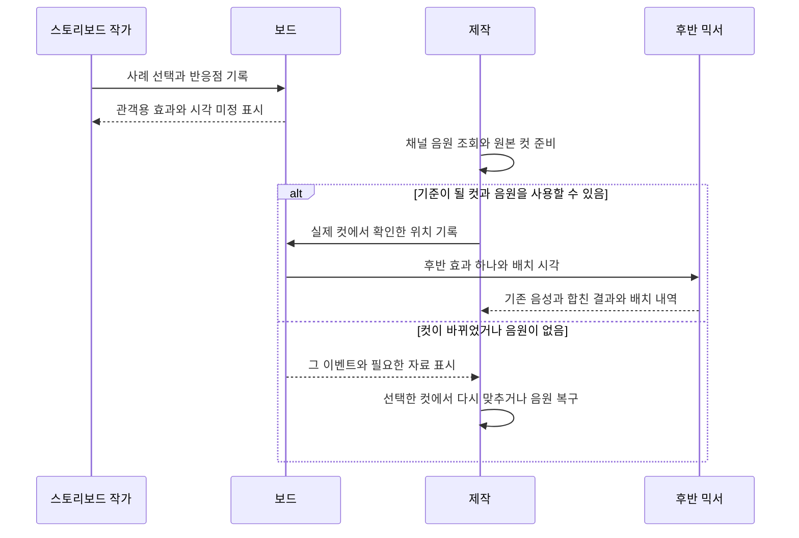

# 관객만 듣는 심리 효과음 설계

**첫 배포의 목표는 편집자가 “누가 무엇을 깨달은 순간에 어떤 소리를 들려줄지” 스토리보드에 적고 그 선택을 최종 영상에서 들을 수 있게 하는 것이다.** 120개 상황은 연출 참고로 쓰고, 소리를 붙일 장면과 비워 둘 장면은 작가가 정한다. 예를 들어 말실수를 뱉은 순간에 짧은 하강음을 붙이면 관객이 먼저 웃는다. 같은 음을 본인이 뒤늦게 알아차린 표정에 붙이면 그 사람의 민망함을 함께 느끼게 된다. [조사 보고서](../../research/2026-11-20-psychological-sound-effects/README.md) · [120개 상황](../../research/2026-11-20-psychological-sound-effects/cases.md)

## 1. 현재 기능과 개선 순서

2026년 11월 20일, 이 워크트리의 기준 커밋은 `3358dd16`이다.

| 현재 동작 | 설계에 미치는 영향 |
|---|---|
| `window.SFX`에 음원이나 생성 설명을 등록한다. `sound.sfx`는 컷 진입점에, `sound.effects[]`는 컷 안의 지정 시각에 효과음을 놓을 수 있다. 채널 카탈로그는 음원을 에피소드 사이에 재사용한다. [현행 보드 규격](../../../skills/storyboard/references/scenes-schema.md#sound-effects-windowsfx-soundsfx) | 카탈로그, 생성기, 시작 시각, 강도 설정을 그대로 쓴다. 현재의 전환·사물 중심 예시에 관객의 감정과 반응을 기준으로 고르는 지침을 더한다. |
| 배포 번들의 `astra_text2video` 준비 함수에 같은 추상음과 표정 설명을 넣었다. `auto`는 `native`로 결정해 그 설명을 영상 프롬프트에 붙였고 `post`는 붙이지 않았다. 두 호출 모두 생성 없이 끝났다. [소유권 결정 코드](../../../server/src/video-sound.ts) | 관객용 효과음은 후반 믹싱이 맡는다. 영상에 쓰는 프롬프트와 배우의 실제 대사·현장음에 관객용 지시가 섞이는 경로를 막는다. |
| 현행 컴파일러는 후반 효과음의 음원과 `atSeconds`를 요구한다. 믹서는 음원 전체를 시작점에 놓으며 효과음 하나만 특정 표정에서 끊는 종료점은 받지 않는다. `sound.silence`는 음악만 줄인다. [컴파일러](../../../skills/produce/references/compile-sound-plan.js) · [믹서](../../../skills/produce/references/build-reel.sh) | 첫 단계는 길이가 맞는 짧은 음원으로 출시할 수 있다. 여러 컷에 걸친 드론이나 정확히 잘라야 할 잔향은 두 번째 단계에서 처리한다. |
| `produce` 본문은 ElevenLabs 효과음 도구를 호출하도록 쓰였지만 스킬의 `allowed-tools`에는 두 설치 이름이 모두 빠져 있다. Desktop 확장 패키지는 `docs/`를 제외한다. [제작 스킬](../../../skills/produce/SKILL.md) · [패키징 규칙](../../../.mcpbignore) | 구현 때 `produce`에 `mcp__social-flow__sfx_elevenlabs_generate`와 `mcp__plugin_social-flow_social-flow__sfx_elevenlabs_generate`를 등록한다. 작가가 쓸 연출 자료는 배포되는 `skills/storyboard/references/`에 둔다. |

| 순서 | 사용자에게 생기는 변화 | 완료를 판별하는 기준 |
|---|---|---|
| 1차 · 장면 선택과 짧은 효과음 | 작가가 사례를 찾아 반응점을 적고 기존 채널 음원을 실제 편집본에 배치한다. 보드에서 선택 이유와 위치를 읽을 수 있다. | 같은 컷에서 반응 시점만 옮기면 음도 한 번만 옮겨 간다. 원본 영상·대사를 다시 만들지 않는다. |
| 2차 · 컷을 넘는 음과 종료 | 다른 컷의 반응까지 드론을 끌거나 그 직전에 잔향을 끊는다. | 실측한 컷 경계에서 해당 효과음만 끝나고 대사·음악·다른 효과음은 계속 들린다. |
| 3차 · 요청 시 비교 청취 | 같은 장면에서 관객용 효과음을 켠 버전과 끈 버전을 듣고 위치나 강도를 고친다. | 동일 구간·동일 기본 믹스에서 새 효과음의 차이만 비교할 수 있고 실제 청취 여부를 구별할 수 있다. |

### 이번 버전에 반영한 믹서 설계

A/B에서 관객용 점음까지 정확히 뺄 수 있도록 점음과 구간음을 모두 `sfx-spans.json`에 한 번만 기록한다. 기존 현장 효과와 수동 편집은 `sfx.tsv`를 쓴다. 두 비교 파일은 같은 본편 프레임과 대사·음악·현장 효과 믹스를 공유하고 공통 피크 여유를 적용한다. 파일 시각은 삽입과 최종 배속을 적용하기 전 본편 기준이다.

## 2. 작가가 장면을 고르는 방법

시놉시스에는 관객이 무엇을 먼저 알게 되는지 자연어로 쓴다. 샷과 대사가 정해지면 `storyboard`가 기존 `story_music` 결정과 함께 감정이 변하는 대목을 살핀다. 무채점 작성 지침이다. 에피소드 형식이나 컷 수에 따른 할당량을 추가하지 않는다.

1. **관객의 출발점과 도착점을 적는다.** “불안하게”보다 “관객은 거짓말을 알고 있고 듣는 사람도 곧 눈치챌까 봐 조마조마하다”가 소리를 고르기 쉽다.
2. **시점을 정한다.** 사건, 말끝, 듣는 사람의 반응 중 어느 순간이 감정을 바꾸는지 고른다. 의심·폭로 장면은 관객이 단서를 알기 전에 소리가 답을 흘리는지 본다.
3. **가까운 사례만 펼친다.** 조사 자료의 12개 묶음과 세 자리 번호를 유지한다. 배포용 색인에서 감정 묶음을 고르면 그 묶음의 10건과 연결된 다른 묶음만 읽는다. 번호는 참고 주소이고 음원 ID는 들을 소리의 이름이다. 배포용 정본은 제안 경로 `skills/storyboard/references/audience-sound/index.md`와 같은 디렉터리의 감정별 파일 12개다. 색인 키는 조사 분류표의 영문 링크 이름을 재사용한다. 조사 문서의 기존 링크와 번호는 이 정본을 가리키게 한다.
4. **한 번 울리기, 반복하기, 이전 음 다시 쓰기, 비워 두기 중 고른다.** 이미 음악이나 연기가 전하는 감정이면 추가 효과음 없이 진행한다. ‘다음 박 생략’은 울릴 이벤트를 만들지 않는 편집이다. 재생 중인 드론을 끊어야 하는 경우에는 그 드론에 종료점을 준다.

| 상황 | 보드에 적을 선택 | 음원과 배치 |
|---|---|---|
| **063 · 뒤늦게 알아챈 말실수** | 듣는 사람이 먼저 곁눈질한다. 관객은 말한 사람이 언제 눈치챌지 기다린다. | “본인의 미소가 굳을 때”에 마른 하강음 한 번. 앞사람의 곁눈질은 비운다. |
| **081 · 늘 있던 사람이 없는 자리** | 앞선 장면에서 두 음을 한 쌍으로 익혀 뒀다. 관객이 없어진 둘째 음을 기다리게 한다. | 같은 첫 음을 재사용하고 둘째 음은 배치하지 않는다. 앞서 들려준 적이 없으면 이 사례의 전제가 성립하지 않는다. |
| **101 · 무사하다는 소식** | 소식을 말한 사람보다 듣는 사람의 어깨가 내려가는 순간에 안도하게 한다. | 점점 뜸해지는 펄스를 쓰고 어깨가 내려갈 때 끝낸다. 편집점에 맞는 음원이 있으면 1차, 끝을 따로 정해야 하면 2차 방식이다. |
| **효과음을 비우는 장면** | 이미 음악이 멎었고 배우가 눈을 피하는 동작만으로 거절을 알아볼 수 있다. | 이벤트와 음원을 만들지 않는다. 기존 배경음이나 원본 트랙의 음량도 건드리지 않는다. |

## 3. 보드와 음원 데이터

저장 위치는 기존 `scenes.js`의 샷별 `sound.effects[]`와 `window.SFX`다. 별도 데이터베이스나 두 번째 재생 목록은 필요하지 않다. 아래는 **제안 규격**이다. 현행 효과음 입력은 엄격한 스키마여서 새 필드는 구현 후에 사용할 수 있다.

| 필드 | 의미와 제약 |
|---|---|
| 기존 `shot.id`, `effect.id`, `sfx` | 샷 ID와 샷 안의 이벤트 ID로 한 번의 사용을 찾는다. `sfx`는 여러 이벤트가 공유할 수 있는 카탈로그 키다. 관객용 이벤트에는 세 값이 필요하다. |
| 새 `effect.audience` | 이 객체가 있으면 관객용이다. `intent`는 관객 감정의 변화, 선택적 `caseId`는 조사 번호, 선택적 `release`는 끝이 중요한 경우의 자연어 지시다. 기존 효과의 목적은 추정하지 않는다. |
| 기존 `trigger`, `description`, `delivery` | `trigger`에는 관찰할 표정·말끝·행동을, `description`에는 소리의 모양을 쓴다. 관객용 이벤트는 보드에 항상 `delivery:"post"`로 저장한다. |
| 기존 `atSeconds`, `intensity`, `separationLu` | `atSeconds`는 **트림을 적용한 컷의 첫 프레임**부터 잰다. 시놉시스나 대사 길이 추정치로 확정하지 않는다. 강도와 음성 대비 레벨은 기존 우선순위를 따른다. |
| 새 `audience.timingBasis` | 위치를 정할 때 도구가 계산하는 편집 기준 해시. 선택한 클립·스틸의 내용, 재생 구간, 관련 대사 테이크·줄 버전, 컷 길이 및 카드 안 배치를 정하는 입력을 사용한다. 파일명이 같은 교체도 잡는다. 2차에는 끝 컷의 기준도 포함한다. 보드 전체 해시를 쓰지 않아 무관한 문구 수정에 다시 맞출 필요가 없다. |
| 2차 `effect.end`, `fadeOutSeconds` | 선택적 종료점은 기존 음악과 같은 모양의 `{shotId, atSeconds}`다. 숫자 또는 컷 끝을 뜻하는 `"end"`를 받는다. 끝은 배타적이다. 페이드는 지정 종료점에서 끝나며 길이 0은 즉시 중단이다. |
| 기존 `window.SFX[id]` | 등록 음원은 `asset`, 신규 제작안은 `prompt`와 `seconds`로 표현한다. 프롬프트에는 음색, 시작 모양, 반복 간격, 감쇠와 꼬리를 적는다. 반복 배경음 키나 BGM 큐로 등록하지 않는다. 파일 경로·권리·영수증은 기존 채널 카탈로그와 생성 기록이 맡는다. |

**이벤트 식별.** 기존 `effect.id`는 선택값이고 영상 준비기는 값이 있는 ID의 중복을 검사한다. ID 없는 예전 이벤트는 배열 순서까지 보존한다. 새 연산은 그것에 임의로 ID를 붙이지 않는다. 한 샷에 같은 ID가 여럿이면 위치나 종류를 짐작해 수정하지 않고 충돌한 항목을 돌려준다. 다른 샷에서 같은 이벤트 ID를 쓰는 것은 허용한다.

**배치 기준 계산.** 읽기·쓰기·컴파일러가 동일한 공용 함수로 버전 1의 SHA-256을 계산한다. 입력은 컷 ID와 종류, 선택된 시각 자산과 재생할 음성의 내용 해시, 프레임에 맞춘 실제 in/out, 컷 길이, 해당 컷 대사의 순서·버전·배치 간격, 해당 컷의 전환·타이밍을 결정하는 값, 이벤트의 시작·종료 지시다. 구간 이벤트는 끝 컷에도 같은 규칙을 적용한다. 키를 이름순으로 정렬한 UTF-8 JSON을 쓰고 배열 순서는 유지한다. 선택한 자산이 아직 없으면 현재 기준은 `null`이고 기획 상태로 읽을 수 있다. 콘텐츠 해시는 기존 미디어 영수증이 현재 파일과 일치하면 재사용한다. 관련 없는 컷, 사례 번호, 강도, 평가 메모, 보드 수정 시각은 해시에서 뺀다. 저장한 초가 없으면 `planned`, 위치와 현재 기준이 같으면 `placed`, 저장한 위치의 기준이 달라졌거나 현재 자산이 사라졌으면 `stale`이다.

아래는 063번의 위치를 실제 컷에 맞춘 뒤 읽게 될 예다. 숫자와 ID는 설명용이다. 25fps 원본에서 미소가 굳는 때가 2.20초이고 원본 앞 0.80초를 잘랐다면 컷 안에서는 1.40초다.

```json
{
  "id": "late-realization",
  "audience": {
    "caseId": "063",
    "intent": "관객도 말한 사람과 함께 뒤늦게 민망해한다.",
    "timingBasis": "<도구가 계산한 해시>"
  },
  "trigger": "말한 사람이 상대의 표정을 보고 미소를 거두는 순간",
  "description": "A single dry synth pluck bending slightly downward, short decay, no voice or background music.",
  "delivery": "post",
  "sfx": "synth-bend-dry",
  "atSeconds": 1.40,
  "intensity": "subtle"
}
```

## 4. 기존 MCP 도구의 확장

**제안 API**는 `storyboard_apply`에 관객용 효과 수정 연산을 추가한다. 현재 `shotsById`는 샷을 통째로 교체하고 `globals.SFX`도 그 블록 전체를 교체하므로 효과 하나를 고칠 때 나머지 데이터를 호출자가 다시 보내는 방식은 피한다. [보드 쓰기 구현](../../../server/src/storyboard.ts)

| 입력·출력 | 동작 |
|---|---|
| `audienceEffects[]` · `plan` | `shotId, id, sfx, intent, trigger, description`과 선택적 사례·강도·종료 지시를 받는다. 같은 키에는 그 관객용 이벤트만 갱신한다. 새 이벤트는 초를 비워 둘 수 있다. 타이밍과 무관한 수정은 기존 위치를 보존하고 트리거가 바뀌면 위치를 다시 맞출 대상으로 표시한다. |
| `audienceEffects[]` · `place` | `shotId, id, atSeconds`와 도구가 읽기 단계에서 제공한 현재 편집 기준을 받는다. 2차에는 `end`, `fadeOutSeconds`를 함께 받을 수 있다. 적용 시 같은 편집 기준인지 확인하고 좌표와 기준을 한 번에 기록한다. |
| `audienceEffects[]` · `remove` | 지정한 샷의 관객용 이벤트 하나만 제거한다. 같은 음원을 쓰는 다른 이벤트와 카탈로그 파일은 보존한다. 이미 없는 키를 제거하면 변경 0건을 반환한다. |
| `sfxEntries` | 같은 패치에 추가할 음원 사전 항목을 ID별로 받는다. 같은 정의는 재사용하고 기존 ID에 다른 음색 정의를 덮으려 하면 새 변형 ID를 안내한다. |
| `expectedSha256`, `dryRun` | 새 수정 경로에서 보드 전체의 읽기 해시를 검증한다. 같은 요청에서 같은 이벤트를 두 번 수정하거나 전체 샷·SFX 교체와 충돌하면 쓰기 전에 알린다. 하나의 패치가 하나의 보드 교체가 된다. |
| `storyboard_read`, 보드 HTML | `shotId, id, intent, trigger, sfx`, 현재 편집 기준, 배치 상태를 보여준다. 시간 미정, 배치됨, 편집 변경으로 재배치 필요를 구분한다. 실제 청취 여부는 별도다. 패치 응답에는 변경한 키와 다시 맞출 키를 돌려준다. |

예를 들어 063번 효과의 음원을 이미 등록했다면 아래 요청으로 초안만 미리 볼 수 있다. `path`와 두 해시 인수는 실제 `storyboard_read` 결과를 사용한다. `place`에서는 `timingBasis`가 두 번째 해시 인수다.

```json
{
  "path": "data/example/episodes/ep01/storyboard",
  "expectedSha256": "<현재 보드 SHA-256>",
  "dryRun": true,
  "audienceEffects": [{
    "op": "plan", "shotId": "s0007", "id": "late-realization",
    "caseId": "063", "sfx": "synth-bend-dry", "intensity": "subtle",
    "intent": "말한 사람이 뒤늦게 느낀 민망함을 관객이 함께 느낀다.",
    "trigger": "본인의 미소가 굳는다.",
    "description": "One dry downward synth pluck, no tail."
  }]
}
```

`plan`은 키가 같은 이벤트의 전달된 필드만 갱신한다. 사례 번호·강도 같은 선택값을 지우려면 명시적으로 `null`을 보낸다. `place`는 읽기 응답의 `currentTimingBasis`를 `timingBasis`에 넣어 보낸다. `shots`와 `full` 읽기에서 개별 이벤트에 `planned | placed | stale` 상태와 편집 기준을 제공하고, 수정 응답에는 `written, changed[], needsPlacement[]`를 제공한다. 입력이 같은 재적용은 `changed:[]`다. `dryRun`은 무엇이 바뀔지만 알려준다.

쓰기 요청은 `dryRun`과 실제 실행에서 같은 입력 검사를 거친다. 이미 존재하는 일반 효과와 ID가 충돌하면 관객용 이벤트로 바꾸지 않는다. 2차에서 끝 샷을 새로 고를 때는 읽기 옵션 `audienceEndFor:{shotId,id,endShotId}`로 그 조합의 현재 기준을 미리 얻는다. 컷과 초를 확정한 `place`가 같은 조합을 다시 계산한다. 입력 검증·샷 수정·음원 정의 병합을 메모리에서 마치고 기존 백업·임시 파일 교체 경로로 한 번에 저장한다. 동시 쓰기는 현재 파일을 기준으로 직렬화하고, 저장 직전에 해시를 다시 확인한다. 충돌이 생기면 최신 보드에서 같은 이벤트만 다시 제안하면 된다. [기존 해시·백업 처리](../../../server/src/storyboard.ts)

## 5. 기획에서 최종 믹스까지



기획 시점에는 영상을 만들거나 유료 API를 호출할 필요가 없다. 생성 영상에서는 `shot_prompt.sound` 작성 지침과 `prepareVideoSound` 두 곳에서 관객용 설명을 모델 입력에서 제외한다. 입력 음성에 미리 섞지도 않는다. 같은 컷의 현장음은 원래 정책대로 준비하고 MSR 원본 음성이나 별도 TTS 선택을 보존한다. 재사용 영상·스틸 카드는 영상 생성 준비를 거치지 않고 편집 좌표에서 바로 합성한다. `broll`과 공용 `outro`는 현재 카드 효과 지원 범위 밖이다. [영상 프롬프트 작성](../../../skills/generate-cut-videos/SKILL.md) · [오디오 소유권과 재사용](../../../skills/produce/references/video-sound.md)

## 6. 재생 위치와 믹싱

```pseudo
관객용 표시가 없으면 기존 효과 처리로 보낸다
관객용 음원과 타이밍을 읽고 선택한 컷과 편집 기준을 비교한다
시작점을 실측한 카드 첫 프레임과 컷 안의 초로 계산한다
종료점이 없으면 기존 sfx.tsv 행을 써서 자연 종료한다
종료점이 있으면 2차 구간 목록에만 쓰고 끝 카드 기준으로 종료 시각을 계산한다
그 구간 음원에만 길이와 페이드를 적용한다
기존 강도와 피크 처리로 후반 효과 트랙에 정확히 한 번 더한다
최종 편집표가 있으면 속도와 삽입 컷을 반영해 납품본에서 들리는 위치를 보고한다
```

1차는 기존 `sfx.tsv`의 컷 내부 오프셋과 강도를 쓴다. 예컨대 컷이 본편 12.00초에 시작하면 예시 음은 13.40초에 울린다. 최종 속도 변경·별도 삽입 전 본편 좌표다. 대응하는 납품 편집표가 없으면 본편 좌표만 표시한다. 베이스 음원이 무음 앞부분을 담고 있으면 그만큼 늦게 들리므로 반응에 즉시 붙일 카탈로그 음원은 첫 유효음이 파일 시작에 있는지 점검한다. 아주 짧은 효과를 측정하는 기존 패딩과 모노 믹스 방식을 활용한다. 현행 모노 출력으로 좌우 이동을 표현하기는 어렵다. 029번처럼 방향이 단서인 사례는 두 음색의 대비로도 뜻이 통할 때만 고른다. [믹서와 강도 측정](../../../skills/produce/references/build-reel.sh)

2차는 컴파일러가 종료점이 있는 이벤트의 시작·끝 샷 ID를 보존해 믹서로 넘긴다. 기존 음악 타임라인에서 ‘카드별 실측 프레임 → 본편 초’ 계산만 공용으로 꺼낸다. 음악 반복·볼륨 곡선은 효과음에 적용하지 않는다. 최종 카드 길이는 스토리보드의 예상 초보다 우선한다. 트림은 실제 채택한 첫 프레임을 기준으로 삼는다. 원본 음성 추출 경로는 프레임 사이에 걸친 시작점을 다음 유효 프레임으로 올린다. 트림은 한 번만 반영한다. 원본 2.20초를 1.40초로 바꾼 값에 믹서가 0.80초를 또 빼지 않는다. [실측 프레임 계산](../../../skills/produce/references/music-timeline.js) · [컷 트림 규칙](../../../skills/produce/references/cinematic-edit.md)

구간이 있는 이벤트는 컴파일러가 소유하는 선택적 `sfx-spans.json`에 쓰고 같은 이벤트의 `sfx.tsv` 행은 만들지 않는다. 파일 정리·해시 기록에는 기존 `sound-plan.json` 방식을 적용한다. 믹서는 **개별 음원을 먼저** 자르고 페이드한 뒤 효과음 트랙에 합친다. 음원이 짧으면 늘이거나 반복하지 않고 자연 종료 시점을 보고한다. 지속이 의도였다면 충분히 긴 채널 음원을 고른다. 종료점이 없는 기존 효과는 원래처럼 파일 끝까지 재생한다. 두 이벤트가 겹칠 때 하나를 끊어도 다른 하나는 계속 들려야 한다. 실제 삽입 영상이나 아웃트로를 가로지르는 지속음은 2차 지원 범위에서 빼고 그 구간을 표시한다.

**음이 시작하는 순간과 꼭대기에 닿는 순간.** 짧은 강세는 첫 유효음을 반응에 맞춘다. 미리 부푸는 라이저는 꼭대기를 공개 순간에 맞춘다. 예를 들어 공개가 컷 안 2.00초이고 고른 파일의 정점이 시작 후 0.60초라면 `atSeconds`는 1.40초다. 이 값이 음수가 되면 앞 카드에서 시작할 수 있는지 살피고 음원 길이·편집점을 고른다. 공개 뒤로 늦춰 끼워 맞추지 않는다. 081번처럼 일부러 빠뜨린 음에는 파일도 배치 시각도 만들지 않는다.

**2차 파일 계약.** `sfx-spans.json`은 `{version:1, spans:[…]}` 형식이다. 각 행은 `shotId, id, assetPath, separationLu, start, end, fadeOutSeconds`를 담는다. `start`와 `end`의 모양은 절 3의 컷 참조와 같고 `assetPath`는 기존 카탈로그 리졸버가 검증한 파일 경로다. 위치 확인 전에는 이 파일을 쓰지 않는다. 컴파일러는 현재 보드에서 유효한 카드 번호와 샷 ID의 대응표도 파일에 `shots:[{id,card}]`로 싣는다. 믹서는 실제 편집표에 대응하는 카드가 있는지 확인한다. 2차를 쓰는 보드에서만 구간 파일을 만들고 기존 마커의 `files["sfx-spans.json"]`에 실제 파일 바이트의 SHA-256을 기록한다. 예전 마커에 이 키가 없어도 읽힌다. 화자가 없는 컷도 기존 믹서의 음량 기준을 쓴다.

**속도 변환.** 본편의 `t = cardStartFrame / fps + atSeconds`다. 최종 편집표가 가리키는 구간의 본편 시작이 `b`, 납품본 시작이 `d`, 그 구간의 재생 배속이 `v`이면 납품 시각은 `d + (t - b) / v`다. 삽입물 길이는 속도 적용 순서까지 반영된 `d`에 담는다. 예시의 13.40초가 처음부터 1.25배로 재생되고 앞에 삽입물이 없으면 납품본 10.72초다. 프레임 오차 검사는 이 변환 뒤의 음원 첫 유효음에 적용한다.

## 7. 실패와 수정

| 상황 | 처리 |
|---|---|
| 보드 초안에 초가 없음 | 의도와 반응점을 읽고 계속 편집한다. 제작 단계에서 선택한 효과의 위치가 여전히 비어 있으면 현행 `post` 계약처럼 그 이벤트를 지목한다. 0초에 떨어뜨리지 않는다. |
| 관객용 표시에 `auto`, `native`, `input`이 직접 섞임 | 전용 쓰기 연산은 항상 `post`를 기록한다. 그 밖의 입력 경로에서 `auto`·생략은 `post`로 정규화하고 명시적인 `native`·`input` 충돌은 프롬프트 준비와 컴파일 양쪽에서 같은 오류로 돌려준다. |
| 테이크 교체·재트림·관련 대사 수정 | 보드 전체의 다른 음원은 재생성하지 않는다. 그 이벤트만 이전 편집 기준으로 표시해 현행 컷에서 다시 배치한다. 앞에 샷이 새로 들어와도 그 컷 내부 위치가 그대로면 본편 절대 시각만 새로 계산한다. |
| 후반 음원이 빠졌거나 이미 같은 소리가 원본에 들림 | 없는 채널 `asset`은 누락으로 보고한다. 생성 설명이 있는 키만 기존 비용 승인 안에서 생성 대상으로 다룬다. 원본에 비슷한 소리가 들어 있으면 실제로 듣고 후반 이벤트를 제거하거나 바꾼다. 원본 음성 전체를 지우지 않는다. |
| 종료점이 사라지거나 순서가 뒤집힘 | 편집 후 유효한 샷과 실측 범위를 표시한다. 끝을 임의로 앞당기거나 구간 전체를 음악 무음 처리하지 않는다. |
| 소리 파일은 있지만 청취 기록이 없음 | 생성·측정·배치 결과를 보여주고 감정 전달과 대사 가청성은 `not_reviewed`로 둔다. 원본 컷 검수와 최종 믹스 청취를 각각 기록한다. |

패치가 오래됐으면 현행 `head_moved`를 돌려준다. 관객용 대상의 중복·일반 효과와의 ID 충돌은 `audience_id_conflict`, 강제된 다른 전달 방식은 `audience_delivery_conflict`, 위치 재지정은 `audience_timing_stale`, 확정 요청의 잘못된 시작·종료 구간은 `audience_span_invalid`로 구별한다. 오류에는 샷과 이벤트 ID가 들어간다. 초안의 미정 상태는 오류로 취급하지 않는다.

## 8. 비용·호환성·운영

작가는 상황 120개를 전부 읽거나 생성하지 않는다. 사례 검색, 보드 변경 미리보기, 시점 조정은 로컬 작업이다. `produce`는 실제 사용하는 ID만 모아 채널 카탈로그를 먼저 조회한다. 기존 같은 음원은 여러 샷과 다음 에피소드에서도 재사용한다. 등록 음원의 권리 기록, 신규 음원의 생성 영수증과 기존 비용 한도를 따른다. 같은 ID로 동시 생성할 때는 채널과 ID별로 한 호출만 진행하고 불명확한 응답은 기존 파일·영수증을 먼저 대조한다. 자산·영수증을 모두 확인한 뒤 카탈로그에 등록한다. 채널의 실제 목록은 `assets/catalog.md`, 효과음의 기본 경로는 `assets/audio/sfx/<id>.wav`다. 조회와 등록은 기존 [채널 자산 리졸버](../../../skills/channel/references/resolve-asset.py)를 쓴다. 음색을 바꿔야 하면 새 변형 ID를 쓴다. 기존 에피소드가 참조하는 파일을 교체하지 않는다.

이전 보드는 이주 없이 읽힌다. `audience`가 없으면 `sound.sfx`, 기존 `effects[]`, 수동 매니페스트와 기존 음악·현장음 처리 방식을 유지한다. 스킬·MCP 도구 정의·영상 준비용 번들·컴파일러·HTML 표시를 같은 플러그인 버전으로 배포한다. 심리음만으로 음성을 켜거나 영상 모델을 바꾸지 않는다. 휴대폰 스피커로도 저음이 들리고 대사의 첫음과 끝음이 선명한지 실제 납품본으로 확인할 수 있게 한다.

1차 수정 지점은 `storyboard`와 `produce`의 스킬·참고 자료, `storyboard_apply/read`와 MCP 입력 정의, 영상 준비의 엄격한 효과 필드 검사, 보드 검사기·HTML, 사운드 컴파일러다. 2차에서 믹서와 시간 계산을 확장한다. 3차 비교 청취는 `produce`의 로컬 구간 렌더 옵션으로 제공한다. 제안 인수는 `--audience-sfx compare --from-shot s0007 --to-shot s0008`이고 시작·끝 샷을 모두 포함한다. `review-cut-videos`에서 요청이 오면 두 구간 파일을 받아 재생한다. 웹 페이지나 MCP 도구를 하나 더 만들 필요가 없다. 요청한 구간만 같은 레벨의 기본 트랙에서 렌더한다. 한쪽은 관객용 이벤트만 빼고 다른 효과·대사·음악은 같은 설정으로 둔다. 별도 피크 정규화로 A/B의 전체 음량이 달라지지 않게 한다. 어느 버전을 실제로 들었는지와 수정 이유를 표시한다.

## 9. 검증할 장면과 합격 기준

| 검증 | 합격 기준 |
|---|---|
| 기획 · 같은 봉투를 읽는 장면을 초조·설렘·배신으로 설계 | 각 안에서 관객이 알아차리는 사실, 첫 음과 마지막 음이 붙는 동작이 구별된다. 적절한 경우 0개를 선택할 수 있다. |
| 입력 · 기존 효과와 새 심리음이 같은 컷에 공존 | 일반 효과는 원래 영상 입력으로 갈 수 있고 심리음은 프롬프트와 입력 오디오에서 빠진다. MSR·TTS·일반 생성·재사용 카드에서 원래 대사 소유자가 유지된다. |
| 쓰기 · 계획, 재저장, 이동, 삭제, 동시 편집 | 이벤트는 한 건이다. 같은 자산을 쓴 다른 컷, 기존 Foley, `sound.drop`, 대사와 시각 자산은 보존된다. 충돌한 쓰기는 재시도 가능한 결과를 준다. |
| 제작 · 컷 안 1.40초, 트림 0.80초, 속도 변경 | 짧은 테스트 음원의 첫 유효음이 예상한 실제 믹스 위치에 한 번 있다. 트림 이중 공제가 없다. 본편 시각과 납품 시각을 구별하고 허용 오차는 납품 프레임 한 장 이내로 비교한다. |
| 제작 · 겹친 두 효과 중 드론만 다음 컷 반응에서 종료 | 드론만 지정 지점에서 멎고 대사·음악·다른 신호는 이어진다. 음악 무음 옵션이나 방 전체의 무음으로 대체되지 않는다. |
| 호환·비용 · 예전 보드, 동일 자산 재사용, 실패 후 재개 | 기준 매니페스트·믹스 동작이 유지된다. 재사용 시 신규 유료 호출 0회. 타임아웃 직후 같은 음원을 중복 발주하지 않는다. |
| 청취 · 실제 반응점과 감정 | 검수자가 요청된 완성본 구간을 듣고 “사실을 너무 일찍 알려줬나, 누구의 반응으로 들렸나, 말끝을 가렸나”를 기록한다. 기술 검사만 마친 경우 청취 항목은 미검수다. |

구현 시 변경한 모듈의 기존 테스트에 사례를 보탠다. 합성한 짧은 톤으로 지연과 종료를 검증하고 외부 생성기는 호출하지 않는다. 기술 회귀는 기존 테스트 파일에서, 장면 해석은 봉투 장면과 063·081·101번의 비교 청취에서 판단한다. [보드 테스트](../../../server/test/storyboard.test.mjs) · [영상 소리 준비](../../../server/test/video-sound.test.mjs) · [컴파일러](../../../server/test/compile-sound-plan.test.mjs) · [실제 믹서](../../../server/test/build-reel.test.mjs) · [보드 HTML](../../../server/test/storyboard-html.test.mjs)

## 10. 작가·제작자·사용자가 결정할 일

| 결정 | 담당과 시점 |
|---|---|
| 감정 분류, 관점, 효과 생략, 기존 음원의 강도 | 작가와 편집자가 이야기·연기·기존 음악을 보고 고른다. 매번 사용자에게 묻지 않는다. |
| 신규 유료 음원이나 재생성 | 확인된 채널 자산을 먼저 쓴다. 요청과 기존 승인 범위가 비용을 포함하면 그대로 진행하고 범위를 넘을 때만 금액과 대안을 제시한다. |
| 사용자가 특정 컷의 소리를 옮기거나 빼 달라고 함 | 그 이벤트만 수정한다. 비용이 들지 않는 위치 변경으로 영상이나 음원을 다시 발주하지 않는다. 한 컷의 피드백을 채널 전체 취향으로 확대하지 않는다. |
| 감정 전달을 실제로 비교해 달라는 요청 | 원본 컷에 아직 없는 후반 효과는 최종 믹스 또는 그 구간의 믹스 미리듣기로 평가한다. 재생·청취가 가능했던 범위를 보고한다. |
