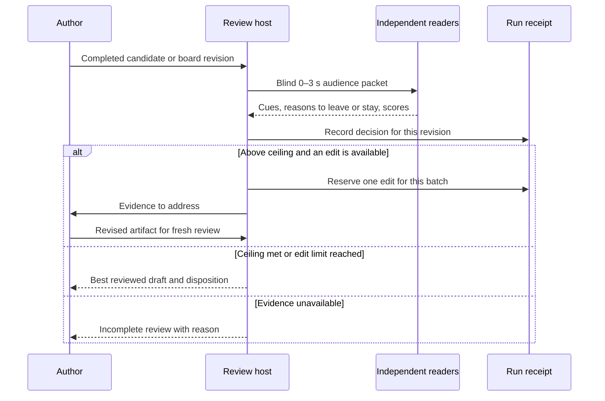

# Opening hook selection and three-second abandonment review

Design proposal for synopsis and storyboard authoring. The two decisions an editor needs to see are which hook the story uses and what a viewer would have seen or heard before deciding to leave.

## 1. Scope and success criteria

Every new or substantially rewritten synopsis candidate selects one of the 18 types in section 3. The chosen candidate supplies the episode's primary hook to the storyboard. Once a synopsis or a text storyboard is complete, an independent reviewer challenges its opening. High abandonment risk sends the draft back for a revision. One authoring run gets at most five revision rounds across both stages.

Success means that a new episode cannot reach text storyboard completion with an absent, invalid or conflicting type. Every authoring handoff reports its review disposition and the revision it covers. Only a fresh, complete review may label that revision as assessed. A synopsis-only request still finishes in chat. The audit distinguishes an editorial score, measured audience abandonment and missing evidence. The feature makes no claim about a change in real audience behavior from an editorial score alone.

## 2. Authoring workflow

1. For each candidate, choose the type that best explains why its intended viewer would keep watching. Identify what the opening lets the viewer see or hear and what the episode delivers. Use an explicit user choice when supplied. Ties go to the mechanism the first event and eventual payoff both support. Two different stories can use the same type. Varying a label does not make two stories distinct.
2. Complete the synopsis and its existing reality check. Send the audience-facing opening from each candidate to the blind review in section 6. Correct a factual dependency if an edit changes it. Deliver the actual checked prose, type label and ID, and a short review result. A synopsis-only request creates no cast, project or episode files.
3. Carry the chosen direction and ID into its scenario and the board's first sequence write. A direct-to-board request selects the type with the first sequence if it has no preceding candidate. When working from a recording, select a mechanism the footage supports. An ingest-only inventory does not author an episode.
4. After the text storyboard has actions, shots and timing, review the audience's first three seconds again. The synopsis result cannot vouch for shot execution. An opening visual may carry a silent story. Long-form work keeps its existing title, thumbnail and 30-second review as well.
5. Show the selected type and the current review result on the author's board overview. Blind reviewers first receive only audience-visible or audible material. Neither the review card nor the synopsis label becomes a spoken line, caption or cover headline.

**Example.** A dumpling vendor opens the steamer. Only the row under the hinge has split. The synopsis selects `cause_mystery`. If the board spends its first three seconds showing the shop sign, the viewer has yet to see anything to explain. Keep the type, open on the split row beside an intact row, then show the drop falling from the lid later. Review the revised opening with the same playback conditions. The evidence for the change is the earlier sight of the split row. An illustrative 60 → 30 points would end the loop after one edit. Those numbers are an example of the decision rule.

## 3. Catalog, records and ownership

Ship one tracked catalog at the proposed path `skills/storyboard/references/opening-hook-types.json`. Each row has a stable ASCII ID, family, English and Korean display labels, and a short selection criterion. Derive membership, tool enums and review labels from that file. The local research report is provenance for this table. Installed plugins must work without a research workspace. IDs retain their meaning when a label is translated or reworded.

| # | Family | Stored ID | Research label | Choose it when the opening invites the viewer to… |
|---|---|---|---|---|
| 01 | Curiosity | `cause_mystery` | 원인 미스터리 | Explain an anomalous observation using evidence. |
| 02 | Curiosity | `identify_from_clues` | 식별·추리 | Identify an unknown person, object or source from available clues. |
| 03 | Curiosity | `predict_outcome` | 예측 질문 | Commit to a prediction before seeing the outcome. |
| 04 | Surprise | `expectation_violation` | 기대 위반 | Notice something contradict an expectation set by the scene. |
| 05 | Surprise | `challenge_belief` | 통념 반박 | Reconsider a recognizable claim in light of counterevidence. |
| 06 | Surprise | `story_outcome_first` | 이미 일어난 결과 | See a later story event and want to know how the characters reached it. |
| 07 | Tension and relationships | `in_medias_res` | 사건 한복판 | Join an unfinished action whose outcome matters. |
| 08 | Tension and relationships | `deadline_choice` | 마감과 선택 | See a choice, a deadline and the cost of delay. |
| 09 | Tension and relationships | `conflict_reaction` | 갈등과 반응 | See a boundary crossed and watch the recipient respond. |
| 10 | Utility and evidence | `finished_result_first` | 결과 선공개 | See a finished result and want the method, effort or cost. |
| 11 | Utility and evidence | `side_by_side_comparison` | 전후·나란히 비교 | Compare states or alternatives under legible conditions. |
| 12 | Utility and evidence | `live_demonstration` | 실험·현장 시연 | Watch a test begin and judge the evidence it produces. |
| 13 | Relevance and trust | `everyday_frustration` | 생활 불편·공감 | Recognize a familiar difficulty and want a response. |
| 14 | Relevance and trust | `audience_condition` | 시청자·조건 특정 | Recognize a situation or condition that applies to them. |
| 15 | Relevance and trust | `firsthand_access` | 기록·현장 접근 | Inspect an original record, location or access the author can substantiate. |
| 16 | Form and sensory cues | `point_of_view_roleplay` | 관점·상황극 | Experience a situation from the enacted viewpoint. |
| 17 | Form and sensory cues | `participation_challenge` | 미션·따라 하기 | Try a task with understandable rules and an observable result. |
| 18 | Form and sensory cues | `sensory_pattern` | 소리·동작·반복 | Follow a distinctive sound, movement or repetition as it develops. |

| Record | Owner and lifetime |
|---|---|
| Synopsis option | `direction`, `text`, `primaryHookType`. A checked chat handoff shows the localized label with its ID beside the prose. On resume, carry the returned candidate and review receipt. If only prose survives, select and validate the type before a new board write. |
| Scenario | The fenced `scenario-json` in `storyboard/candidates/dN.md` owns the candidate's value. Selection copies it unchanged into the same fence of `storyboard/scenario.md`. Frontmatter still identifies the direction. |
| Board | `STORY.primaryHookType` is the episode's saved value. New boards stamp `STORY.hookContractVersion: 1` on first authoring. Both fields are protected on later writes. Scenes, shots, platform versions and the cover read the episode value when needed. |
| Review receipt | Keep the receipt in the conversation for synopsis-only work. Once a board is written, persist the run beside it in the proposed `storyboard/opening-review.json`. Import the synopsis receipt on handoff. Store run ID, stage, candidate ID, revision hashes, settings, completed/reserved round numbers, reviewer evidence and scores, disposition, and a recoverable best draft per stage and candidate. Hash the selected type, source language, audience/surface, opening actions, actual visible text, shot order, frame rate, timing, sound, framing and payoff evidence. The existing story hash alone omits timing and framing. Exclude the ledger itself. Keep a recoverable opening patch against its parent revision and preserve unrelated later edits when restoring it. |

Several names already have owners. `STORY.opening` holds the sequence opening plan or an event reference, depending on the board contract. The cover's `hookType` and `hookForm` describe packaging. Scenario `engine` and `reveal` describe the larger narrative. Keep their accepted values and update semantics. [Sequence schema](../../../server/src/storyboard.ts) · [Scenario format](../../../skills/storyboard/references/character-scenarios.md) · [Cover vocabulary](../../../skills/storyboard/references/scenes-schema.md)

## 4. Tool and storage boundaries

| Entry point | Proposed contract |
|---|---|
| `scenario_check` | Keep the current path input and response compatible. Add a mutually exclusive inline `synopses` input with one or more complete options, unique direction keys, nonempty prose and exactly one catalog ID per option. Return validated options or located violations. Path checks gain an explicit authoring mode for newly written candidates and selected files. These checks need no cast for inline prose. |
| Scenario authoring CLI | The skill calls the same pure selection check as the tool. Carry structural hook errors through the current severity filter as blocking findings. A normal MCP response can contain violations. The caller must inspect them before delivery or selection. |
| `story_sequence` | Add optional wire field `primaryHookType` with the catalog enum. On creation inherit the selected scenario's ID, or require explicit input if the selected file is absent. If the file exists, require a valid matching selection. On an ordinary sequence upsert, omission preserves the saved value. Updating `opening` retains its existing replacement behavior. Change both Zod and the separately declared MCP input schema. |
| Intentional change | The author edits the selected scenario first if one exists. Reconcile on an explicit write with the old board SHA, old ID and new ID. For first-time enrollment of a legacy board use its current SHA and absent old ID. Keep the usual approval invalidation for edited boards. A different ID supplied on an ordinary edit is a conflict. |
| Board mutation and completion | Check the resolved board, stage and selected scenario in the common write path. Protect the fields against raw `storyboard_apply` replacement, removal, conflicting scene/shot writes and generic-board promotion. A standalone author's first raw `set` with story content must supply the ID or inherit it, just like the sequence writer. An empty scaffold is enrolled when it first gains story content. `storyboard_check` reports integrity failures. `production_workflow.complete(text_storyboard)` independently enforces the hook on enrolled boards. Surface the actual review disposition there. A stale or absent receipt cannot appear as reviewed. Completion of authorized production work and a favorable editorial verdict are separate decisions. |
| Review orchestration | Extend the existing storyboard reviewer with a blind opening-only task and a structured verdict. The authoring host supplies fresh reviewer contexts, the shared validator verifies the packet hash, independent reviewer IDs, evidence and scores. Expose one proposed `story_opening_review` MCP tool with `prepare`, `record` and `reserve_revision` actions, backed by the same logic for inline and file inputs. Inline calls return the updated receipt to the caller without writing a board. File-backed calls take the board path and expected revision. The result includes the run ID, artifact and packet digests, status, current metric and units, rounds used and remaining, findings and best revision reference. `prepare` returns an audience packet plus private coordination data kept apart from it. `record` assembles the scored receipt. `reserve_revision` checks the current revision and consumes a numbered slot before an edit; retries reuse the reservation. List the new tool and extended `scenario_check` in both installed name forms wherever the skills call them. |
| Read and offline display | Return the type, localized label, review stage, risk score or observed rate with units, and round count to the author. Read the checked receipt for the current revision. Bundle the catalog labels and the saved review summary into the standalone HTML through its existing generation path. Refresh the derived display when the saved revision changes. The blind export omits these fields. |

| Review action | Required input and invariant |
|---|---|
| `prepare` | Supply stage, surface, audience brief, and exactly one source (inline candidate batch or board path). For a continuation supply the prior run receipt or its file-backed ID. The tool derives source and packet digests, applies the same saved policy, and returns each packet separately from private metadata. |
| `record` | Supply run ID, stage, candidate, source and packet digests, and policy version. An assessed result requires three distinct host review invocations with five ratings each and evidence for each positive rating. Optional eligible measured data carries the fields in section 6. A failed assessment records `incomplete` and the missing evidence. Compute the disposition server-side. Reject stale digests and conflicting retries. |
| `reserve_revision` | Supply run ID, stage, current receipt revision, request ID and sorted failing candidate IDs with their source hashes. Reserve only for a recorded above-ceiling value and available stage budget. One request ID returns the same slot on an identical retry. A reused ID with a changed payload fails. |

**Example tool exchange.** After three blind reads on a board, the host sends `record` with the prepared packet digest, source revision, rubric version and the three verdicts identified by independent host review contexts. Reviewer identity here means a distinct host review invocation, without any claim of an external audience. The tool computes the median and returns an author-facing response of this shape (digests abbreviated).

```json
{
  "runId": "episode-07-opening",
  "stage": "storyboard",
  "direction": "D1",
  "sourceRevision": "3b9…",
  "packetDigest": "c27…",
  "status": "high",
  "metric": { "kind": "editorial_risk", "value": 60, "unit": "points", "ceiling": 40 },
  "findings": [{ "at": "0.0–2.8 s", "cue": "Only the shop sign is visible." }],
  "editsUsed": 2,
  "editsRemaining": 3,
  "bestRevision": "3b9…"
}
```

For a direct board delivery outside a managed production workflow, the storyboard skill must call the same final review procedure after the shots exist and before delivering the board/HTML. Preserve typed statuses (`pass`, `high`, `limit_reached`, `incomplete`, `stale`) separately from the metric kind. The returned status describes the loop outcome and the numeric value retains its units. File-backed reservations use one immutable sorted list of candidate IDs and before-hashes per batch. Reject edits for unlisted candidates on that reservation. On the inline path a single owning host serializes calls and carries the latest receipt. Offline copies of a chat cannot coordinate a distributed lock.

No database or remote review service is required. Reuse filesystem paths relative to the board, SHA checks, and atomic file replacement. The schema, CLI and offline page must load the same shipped vocabulary. [Board writers and readers](../../../server/src/storyboard.ts) · [Public MCP schemas](../../../server/src/tools.ts) · [Workflow completion](../../../server/src/production-workflow.ts)

## 5. Review sequence and evidence



| Step | Synopsis | Storyboard |
|---|---|---|
| Prepare a blind packet | Extract a plausible 0–3 s rendition from the actual synopsis opening in story language. Include only what could be seen, heard or read in that time. Mark timing as estimated and map each cue to the source sentence. | Clip the ordered shot actions, visible text, audible events and spoken fragments to `[0, 3.0 s)` at the saved frame rate or stated timing estimate. Include a second shot only if it begins before the cutoff. Use an existing timed preview when available. |
| Challenge | Three independent reads start with the same audience brief and playback conditions. Each records the earliest reason to swipe, the cue and time or beat supporting it, and any concrete reason to stay. | Repeat with fresh contexts even if the synopsis passed. A whole line ending after 3 s, a director's note and a later reveal cannot earn early credit. |
| Compare with the story | After the blind answers are locked, the editor compares the opening against the selected type and the delivered payoff. | Check the actual first shot and later payoff. Report a changed type or a misleading promise to the existing story checks. Hook validity and factual fidelity still apply at any score. |
| Decide and present | Assess each requested candidate. A single high-risk candidate can be revised without rewriting the others. Count one batch of edits as one round. | Save the best valid board opening, the remaining issue if any and the evidence behind the decision. Review status travels with the artifact revision. |

An intentionally silent or ambiguous opening can pass when a reader can report what drew their attention and why. Supply the title or thumbnail only if the viewer would already have seen it on that surface. Hold the audience brief, language, playback conditions and rubric constant across revisions. Withhold the threshold, type, writer's intentions, previous score and ending from the blind readers. Missing or contradictory timing makes evidence `insufficient` when it could change what is credited before the cutoff. Repair the packet or source timing before judgment.

## 6. Scoring and revision logic

**Editorial risk.** Each reviewer scores five observable sources of early exit: an unreadable first cue, missing context needed to follow it, no discernible reason to continue, delay before the first meaningful event, and competing visual or audio information that obscures that event. For each, use 0 for no evidenced obstacle, 1 for friction with a readable cue still present, and 2 for an obstacle that prevents the viewer from following the opening or finding a reason to stay. Each nonzero score cites a cue, omission or time. Multiply the sum by 10, then use the median of the three reviewer totals. The result is a risk index from 0 to 100 points. Use **40 points** as the proposed pilot ceiling. A score **above 40** triggers revision. Exactly 40 passes the score check. Set the ceiling once per run. It is a tunable editorial choice, without a claim of population calibration. To tune it, pair archived board-opening scores with exact-version 3 s measurements from the same channel and surface. Select a ceiling on earlier releases and check how often it correctly flags high abandonment on later releases. Report misses, false alarms and cohort size. A new ceiling applies only to future runs.

**Observed abandonment.** When the exact version, surface and comparable audience have actual observations, compute the rate as 100 × eligible starts that ended before 3.0 s ÷ eligible starts, or use the platform's explicitly equivalent metric with its own documented denominator. Include viewers eligible to reach 3.0 s, handle repeats consistently and exclude shorter clips. A zero denominator is unavailable. Record the source, observation window, audience, sample size and revision identity. Compare a qualified rate with a separate, preregistered channel ceiling in **percent**. For example, a measured 38% exceeds a 35% ceiling. Establish minimum eligible sample size for that channel before inspecting the result. If the sample, metric or version does not qualify, use the editorial path. Keep the measured result descriptive when it cannot be compared. For eligible measurements the observed rule takes precedence over the proxy. A previous release's rate cannot certify a newly edited draft. Do not infer an exact 3 s rate from YouTube Shorts' “stayed to watch”, a 30 s intro metric, views or a six-second ad view.

```pseudo
Review the original at each stage as round zero. Share one counter across the run.
If evidence is insufficient, retry acquisition for the same revision or report incomplete.
If any eligible candidate exceeds the applicable abandonment ceiling:
    If the five slots are used, end the loop with the best valid draft and its unresolved findings.
    Reserve the next slot for the failing batch, keyed by run, stage and batch revision.
    Revise the implicated opening cues. Preserve type, facts, character continuity and payoff.
    Recheck affected facts, assemble a new packet and collect fresh blind verdicts.
    Compare to the best eligible revision at this stage under the same scoring policy.
    Repeat for candidates that still need work.
Otherwise deliver the reviewed synopsis or complete the reviewed board.
```

Within an evidence class, prefer a valid draft that clears the ceiling, then the lower risk value, then the earlier draft. If two drafts use different evidence classes, use the shared editorial rubric to order drafts with the same disposition. Prefer one that clears its applicable ceiling. Keep measured and editorial numbers on separate scales. Keep any qualified measured failure attached to its original. Never restore a draft that fails the type, fact or payoff checks. Starting the board triggers a fresh assessment with the balance of the **same five edits**. For example, two synopsis revisions leave three for the board. For a combined request, reserve one of the five slots for the board. If a synopsis still scores high after four edits, hand off its best valid version with that finding so the board can use the final slot. A synopsis-only run may spend all five. Its selected candidate carries that history into a continuation. In a continuation with no edits left, the board still receives its own initial assessment. Multiple reviewers, initial assessments and exact retries use no revision slots.

## 7. Failure, resume and older work

| Condition | Result and recovery |
|---|---|
| Missing, null, unknown, translated or multiple IDs | Return `hook_type_required` or `hook_type_invalid` with the candidate or field path. Author fixes the choice. No automatic default. |
| Selected scenario and board disagree | Return `hook_type_conflict` before saving or certifying the stage. Re-read the selected file, then reconcile explicitly. An invalid selected file is an error even if the caller supplies a valid ID. |
| Concurrent edit or worker restart | Bind reservations, evidence and receipts to the source revision and policy. Use a per-run lock and atomic replace for its ledger. Pass the original outline read's SHA into the board writer's final compare-and-swap. Check the selected-file revision at commit and completion. A crash between the board write and receipt creates a pending review, repaired by retrying the same reserved round, never a completed stage. |
| Missing reviewer, unusable timing or stale receipt | Mark `incomplete` or `stale`. Fix missing evidence or repeat a read on the current revision. Correcting packet extraction, timing evidence or a failed evaluation consumes zero edits. An editorial rewrite consumes a slot only after an eligible high-risk result reserves it. After one failed retry, report the reason and current draft as unreviewed and continue within existing authorization. A later recovery may finish the same reservation. |
| Fifth revision still high | Return `limit_reached`, report the best evaluated revision and its specific risk. Deliver the best valid revision with the status and score. Continue any already-authorized downstream work with the finding attached. A synopsis-only request ends at the synopsis. Preserve existing explicit approval stops and spending limits. |
| Old board or scenario | Allow archival reads, minor edits and media repairs. Display an absent selection as “unclassified”. A new candidate, replacement opening, explicit type assignment or newly authored board enters the contract. In legacy work, detect replacement of opening events/plan or a wholesale story rewrite by comparing the old and proposed content. Keep archival inspection separate from authoring mode. |
| Receipt missing on a resumed chat | The synopsis-only receipt is part of the user-visible handoff. Recover it from the selected chat artifact or the board ledger first. When a continuation's consumed budget cannot be recovered, report that fact and show the current draft. Continue the authorized work with the review history marked unknown. Replenishing an unknown or exhausted budget requires an explicit new review request. |

The mandatory review belongs at completed authoring stages. Incremental sequence, scene and shot writes must still be able to build a draft before there is a three-second packet to review. A successful review cannot make invalid story data writable.

## 8. Implementation scope and operating constraints

Ship in dependency order. First add the catalog, shared validation, synopsis handoff and sequence/board protection. Next add packet extraction, the blind reviewer task, round accounting and the text-storyboard completion check. Finally expose the results in the offline review page and unattended authoring flow. Release those parts together before claiming the contract is enforced.

Update the [storyboard skill](../../../skills/storyboard/SKILL.md), [unattended production](../../../skills/autoproduce/SKILL.md), [shared production workflow](../../../skills/_shared/production-workflow.md), [scenario checker](../../../skills/storyboard/references/check-scenario.js), [board reviewer](../../../agents/storyboard-reviewer.md), the tool list and the shipped server bundle. Document the shared budget and the distinction between a required review attempt and its verdict in the [automation guidance](../../../skills/_shared/automation-guidance.md) and alongside the existing [editorial review rules](../../../skills/storyboard/references/character-scenarios.md). Its score applies only to the opening. Reuse existing timelines and approved material. External uploads, publishing, paid audience panels, video rendering and analytics collection are outside an ordinary design review.

## 9. Acceptance tests

| Case | Expected result |
|---|---|
| Catalog and language | All 18 unique IDs match the public enum, runtime, CLI and offline labels. Translation and changing the board language preserve the ID. Rows 06 and 10 remain distinct. |
| Synopsis only, alternatives, unattended | Validate each candidate independently with no filesystem/project prerequisites. Two candidates can share a type. Reject a candidate with no valid type even when the MCP call succeeds at transport level. |
| Selected, direct and existing boards | Cover inheritance, conflict, absent or malformed selected file, explicit initial input, omission on upsert, legacy opening rewrite, legacy read, generic scaffold promotion, and raw replace/delete. Keep old opening replacement and cover vocabulary tests passing. |
| Window and blindness | Test a silent opening, a cut at 2.5 s, a cut exactly at 3.0 s, a line crossing 3.0 s, missing timing and a long-form title. Blind packets contain no type, intention, ending or previous score. |
| Decision and measurement | At 40 points the editorial rule passes, at 50 it revises. Qualified 38% versus 35% revises, equality passes. An incompatible metric, a tiny sample or another revision cannot override the proxy. A persuasive opening with a false payoff is flagged separately. |
| Shared ceiling and rollback | Original passes with zero edits. Two synopsis and three board revisions consume the allowance. A second high candidate in the same batch, repeated calls and concurrent retries cannot open a sixth slot. A worse final draft returns the best valid one and visibly reports any unresolved risk. With one reserved board slot, a fourth unsuccessful synopsis edit hands off with its findings. |
| Resume and review integrity | Exercise interrupted reservations, failed writes, source changes, manual reselection, identical retries, stale imported receipts, and editorial statuses bound to exactly one revision. Repair a timing error and verify a changed packet digest with zero revision slots consumed. A stale or missing review never displays as passed. It does not block unrelated authorized work. Absence of a valid hook on an enrolled board prevents text-storyboard completion. |

Add cases to the existing module suites where they exercise an existing entry point. Verify the plugin through its installed MCP bundle and the standalone HTML as well as the CLI. Run the repository's server checks and skill lint when implementing the feature.

## 10. Decisions that need a person

| Trigger | Decision rule |
|---|---|
| T1 · editorial policy | A user-specified hook, target audience or ceiling takes precedence. Fix choices before seeing scores. A silent opening or two candidates sharing a type needs no special approval. |
| T2 · audience data | Use authorized aggregates for the same version and definition. Any new access to private channel data requires the owner's authorization. |
| T3 · new dependency | The default design uses the existing host and local files. Commissioning an audience panel or a paid render is a separate user decision. |
| T4 · destructive change | Never overwrite an unrelated draft, backfill the archive, switch a user-selected type, or restart an exhausted budget automatically. |

| Case | What the user decides |
|---|---|
| HITL-01 · unresolved high risk | After the fifth edit, show the best opening, its evidence and the unresolved risk. If the author requests another cycle or a different hook, that request defines a new scope. The normal run delivers the result and continues work already authorized without a new approval. |
| HITL-02 · explicit selection conflicts with the material | Show the concrete mismatch and the smallest edit that would honor the selection. Ask about changing the type only if the existing choice cannot be honored within the authorized rewrite. |

When a decision is necessary, ask one question, identify the affected revision, give concrete options, and explain what each option changes. Catalog lookup, initial selection without a stated preference, routine review, and in-budget opening revisions proceed automatically. Engineers can choose helper names, test fixtures and equivalent offline serialization details within this contract.
